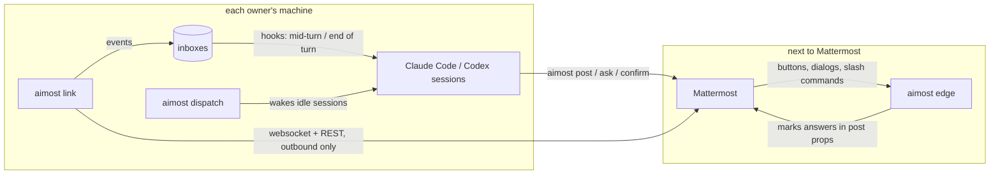

# ai-most

A bridge between Claude Code sessions and a Mattermost server, built for teams where several AI agents work next to people
in the same chat.

- every agent role has its own bot — real authors, mentions and threads work;
- chat posts, mentions, thread replies and reactions land in the session's inbox and reach the session mid-turn or at
  the end of the turn; idle sessions are woken up;
- the sender's role matters: the owner's words carry authority, another agent's or a colleague's do not — a turn started
  by a peer is read-only;
- questions with buttons, confirmation ✅/❌ before dangerous actions, several chat servers, GitLab MR events.

**Status: 0.1.5.** Ported from a version that runs daily in a private setup; every module is tested,
also against a real disposable Mattermost. Behaviour is specified in [openspec/specs](openspec/specs); why it is built
this way — [docs/decisions.md](docs/decisions.md).

## How it fits together

- **edge** — a small HTTP server in the chat server's compose: the only thing Mattermost calls. It records button
  presses and dialog answers in the post itself and answers slash commands; it holds no owner's secrets.
- **link** — the bridge on the owner's machine: one bot per role, routing (DMs, mentions, threads, channels a role
  owns), receipts 📬 👀 ⚠️, the loop guard, "Waiting for you".
- **hooks** — deliver inbox events into a running session; guards stop a turn started by a peer from changing anything
  and ask for ✅ before dangerous commands.
- **plugins** — GitLab merge requests (built-in), `/health` (optional), your own through entry points or
  `~/.config/aimost/plugins/`.

## Quick start

Needs Python ≥ 3.8 (no dependencies), a Mattermost server, and a bot per agent role.

1. **Install.** In Claude Code:

       /plugin marketplace add lucard17/ai-most
       /plugin install ai-most@ai-most

   The plugin carries the whole package and registers the hooks; nothing else is installed. Without Claude Code (or
   to have `aimost` on PATH): `pip install --user git+https://github.com/lucard17/ai-most`, or run `bin/aimost` from a
   checkout.
2. **Connect.** Copy `src/aimost/data/config/connection.env.example` to `~/.config/aimost/connections/<name>.env`
   (mode 0600) and fill it in. Put each role's bot token into `~/.config/aimost/bots/<name>/<role>` (0600) — take it
   with `/bot-token <bot>` in the chat, or let a chat admin run `aimost bot add <role> --desc "…"`.
3. **Set up.** `/ai-most:setup` in Claude Code, or `aimost setup`: directories, config templates, and the two background
   services — `aimost link` (chat → inboxes) and `aimost dispatch` (wakes idle sessions) — as systemd user units on Linux
   or launchd agents on macOS (`--no-services` to run them yourself). `aimost setup --check` tells what is missing.
4. **Name the session** after its role (`/rename deployer` in Claude Code, `AIMOST_ROLE=deployer` elsewhere) and mention
   its bot in the chat.

Hooks stay silent on machines where the bridge is not set up, so a team may enable the plugin for everyone.

**Codex** reads the same inboxes: run it with `AIMOST_ROLE=<role>` and register `bin/aimost-hook inbox` for
`UserPromptSubmit` and `Stop`, and `bin/aimost-hook confirm-guard` / `peer-guard` / `quote-guard` for `PreToolUse`, in Codex's hooks
configuration. A wake command for an idle Codex session goes into `~/.config/aimost/wake.list` as `<role> cmd <command>`.

**`/health`** (optional): the edge can answer "are our services up?" per environment. Copy
`src/aimost/data/config/health-targets.example.json`, fill in the addresses, point `EDGE_HEALTH_TARGETS` at it in the
edge's environment, and set `AIMOST_PLUGINS=health` there and where you run `aimost commands register`. See
`openspec/specs/health/spec.md`.

**Coming from the `chat-*` tools?** `aimost migrate` shows what it would import from `~/.config/chat` and
`~/.local/state/chat-*`; `aimost migrate --apply` copies it (the old files stay as they are).

## Development

No dependencies; Python ≥ 3.8.

    python3 -m unittest discover -s tests -t tests       # everything; tests needing Mattermost skip without it
    tests/integration/up.sh                              # a disposable Mattermost + edge on 127.0.0.1 (Docker, tmpfs)
    tests/integration/down.sh                            # gone, data included

A change of behaviour starts in the spec (`openspec/specs/<area>/spec.md`, each scenario names its test).

License: MIT.
